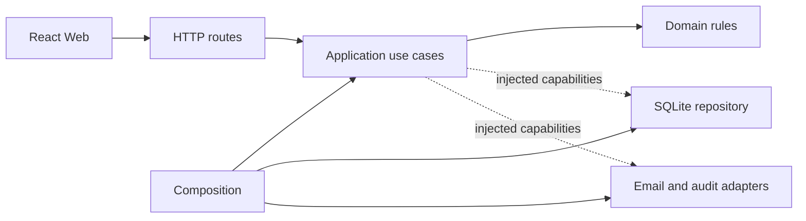

# البنية المعمارية

## الحدود الحالية

المشروع تطبيق ويب بواجهة React وخادم Express وقاعدة SQLite. مسؤولية `server/app.js` تجميع middleware والمسارات والأصول الثابتة. مسؤولية `server/index.js` بدء HTTP وWebSocket والجدولة وتهيئة بيانات البداية. يبقى `index.js` نقطة تشغيل الخدمة ويصدر التطبيق للتوافق مع الاختبارات القائمة.

وحدة الفواتير أصبحت مفصولة بالكامل بين نقل HTTP وقواعد الفواتير وحالات الاستخدام والتخزين. بقية وحدات الخادم ما زالت تستخدم التنظيم السابق في `routes/` و`services/`، ويجري نقل أي وحدة لاحقة بهذه الحدود عند العمل عليها؛ ليست كل المسارات قد تحولت إلى Clean Architecture بعد.

## توزيع المسؤوليات

| الموقع | المسؤولية | الحدود |
|---|---|---|
| `client/src/api/` | اتصال الواجهة بالخادم وإدارة refresh | لا تُكرر قواعد الصلاحيات الخلفية هنا |
| `client/src/components/` | الشاشات بحسب المجال والمكونات المشتركة | الواجهة تستهلك عقد API الموجود |
| `server/domain/billing/` | حالات الفاتورة والتحقق والحساب والترقيم | JavaScript مستقل؛ لا Express أو SQL أو أسرار بيئة |
| `server/application/` | حالات استخدام الفواتير وأخطاء التطبيق | تعتمد على domain وقدرات محقونة فقط |
| `server/infrastructure/repositories/` | SQL ومعاملات SQLite | تنفذ عقد التخزين المطلوب من التطبيق |
| `server/composition/` | إنشاء المستودع وربط الصلاحيات والبريد والتدقيق | المكان الوحيد لربط التبعيات الفعلية لوحدة الفواتير |
| `server/routes/` | تحويل طلب HTTP إلى استدعاء والرد إلى JSON | مسار الفواتير لا يحتوي SQL أو حساب مبالغ |
| `server/middleware/` | المصادقة وعزل المكاتب وترجمة أخطاء التطبيق إلى HTTP | `INVALID_INPUT` → 400، `FORBIDDEN` → 403، `NOT_FOUND` → 404 |
| `server/services/` | خدمات مشتركة ووحدات قائمة قبل الفصل | تبقى حتى تُنقل وحدة لها نطاق واختبارات محددة |

## عقد الفواتير

`createInvoiceService` يستقبل `repository` و`canAccessCase` و`canAccessInvoice` و`sendEmail` و`logActivity` و`clock` الاختياري. لا يعرف Express أو قاعدة البيانات الفعلية. ينفذ المستودع القراءة والمطابقة والترقيم المخزن والحفظ والتعديل والحذف والعمليات الذرية. لا تستخدم `req` أو `res` في حالات الاستخدام.

بقيت المسارات `/api/invoices` وعقد الاستجابة وحواجز الصلاحيات كما كانت. إنشاء الفاتورة وبنودها داخل معاملة واحدة، وتعديل البنود ذري، والتحقق من مكتب القضية والموكل إلزامي. فشل إرسال البريد لا يغير الحالة إلى sent ولا يسجل نجاحاً.

## قواعد التوسع

1. ضع القاعدة التجارية المستقلة في domain واختبرها دون خادم أو قاعدة بيانات.
2. اجعل حالة الاستخدام تستقبل قدرات خارجية صريحة بدل استيراد تنفيذها.
3. ضع التخزين في infrastructure والربط في composition.
4. احتفظ بمسار HTTP والعقد الحالي عند نقل وحدة قائمة.
5. شغّل فحوص الحدود والاختبارات الوظيفية قبل النشر، وأدرج كل الملفات الجديدة في حزمة الإصدار.

`npm run test:architecture` يفحص اتجاه استيرادات domain/application، وفصل تشغيل الخادم، وإعداد العميل للويب. هذا فحص للحدود المحددة وليس إثباتاً آلياً لنظافة جميع وحدات المشروع.

## الأرشيف والبيانات

كود Electron وإعداد التغليف السابق داخل `scripts/archive/desktop/`، ولا يدخل بناء أو نشر الويب. أدوات Windows القديمة موجودة للتوافق التاريخي ولا تمثل المنتج المنشور. لا تُحذف قواعد البيانات أو المرفقات أو النسخ الاحتياطية عند التنظيف. سجلات QA ونتائج النشر محلية داخل artifacts أو deploy حسب نوعها.
